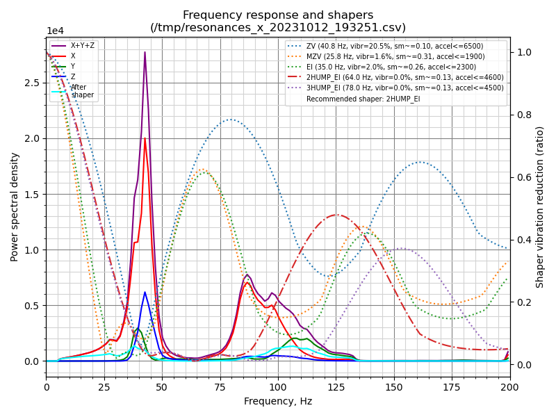
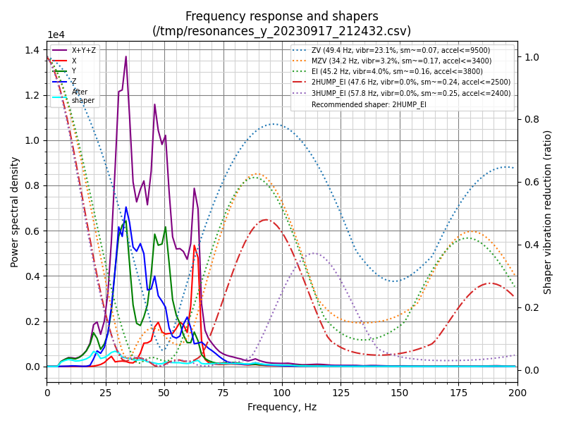

# Ender 3 V2 Klipper Configuration

Klipper configuration files for my heavily modified Ender 3 V2 3D printer.


## Table of Contents

- [Hardware Specs](#hardware-specs)
- [Configuration Files](#configuration-files)
- [Slicer Setup](#slicer-setup)
- [Macros](#macros)
- [Input Shaper Results](#input-shaper-results)
- [Useful Links](#useful-links)

## Hardware Specs

| Component | Details |
|-----------|---------|
| **Mainboard** | Stock Creality 4.2.2 (STM32F103) |
| **Motion** | 3DFused linear rails X/Y/Z |
| **Z-Axis** | Dual Z with 1.8° Creality steppers |
| **Hotend** | Creality Sprite Pro Extruder |
| **Probe** | BLTouch (physical endstops on XY) |
| **Accelerometer** | KUSBA ADXL345 (Rampon Firmware) |
| **Filament Sensor** | Trianglelab runout sensor |
| **Cooling** | Noctua NF-A9-14 PWM (PSU + Mainboard) |
| **Lighting** | 12V 6000K COB LED strip (480 LED/m) |
| **Camera** | ELP 1080P USB3.0 (IMX291, 50fps) |
| **Host** | Raspberry Pi 4B 8GB + Official 7" Display |

## Configuration Files

| File | Description |
|------|-------------|
| `printer.cfg` | Main printer configuration - steppers, bed, extruder, probe |
| `macro.cfg` | Print macros - START_PRINT, END_PRINT, filament handling |
| `mainsail.cfg` | Mainsail client macros (owns PAUSE/RESUME/CANCEL_PRINT, virtual_sdcard) |
| `KAMP_Settings.cfg` + `KAMP/` | Klipper Adaptive Meshing & Purging settings |
| `moonraker.conf` | Moonraker API server configuration |
| `moonraker_obico_macros.cfg` | Obico first-layer scan macros |
| `moonraker-obico-update.cfg` | Obico update_manager entry |
| `octoeverywhere-system.cfg` / `octoeverywhere.conf` | OctoEverywhere remote access |
| `crowsnest.conf` / `sonar.conf` | Camera streaming / link monitoring |
| `KlipperScreen.conf` | Touchscreen UI configuration |
| `timelapse.cfg` | Timelapse recording settings |
| `adxlmcu.cfg` | ADXL345 accelerometer configuration |

> **Not tracked** (see `.gitignore`): `moonraker-obico.cfg` (contains the Obico
> account `auth_token` — keep it off the public repo), the `Spoolman/`
> database and rotated `*.log` files.
>
> **Section ownership:** `PAUSE`, `RESUME`, `CANCEL_PRINT` and `pause_resume`
> are defined once, in `mainsail.cfg`. They were previously also redefined in
> `macro.cfg`; since Klipper parses with `strict=False`, the last include
> silently won, making behaviour depend on include order. The duplicates were
> removed so the maintained mainsail client macros are authoritative. `G29`
> lives once in `printer.cfg`.

## Slicer Setup

### OrcaSlicer / PrusaSlicer / SuperSlicer

**Start G-code:**
```gcode
START_PRINT BED_TEMP=[bed_temperature_initial_layer_single] EXTRUDER_TEMP=[nozzle_temperature_initial_layer] MATERIAL=[filament_type]
```

`MATERIAL` picks the per-material pressure advance in `START_PRINT`. Without these
parameters the macro falls back to 60C bed / 210C nozzle / PLA pressure advance.

### OrcaSlicer presets (`orca/`)

Ready-made presets for this printer (Sprite Pro direct drive, 0.4 nozzle). Import with
**File > Import > Import Configs...** and select the `.json` files, printer first.

| Folder | Presets |
|--------|---------|
| `orca/machine` | `MyKlipper 0.4 nozzle - Sprite DD` (start G-code passes temps + material) |
| `orca/filament` | PLA, PLA+, PLA HS, Silk PLA, Matte PLA, Wood PLA, PLA-CF, PETG, PETG-CF, ABS, ASA, TPU 95A, TPU 85A, eSUN TPU LW (foam) |
| `orca/process` | 0.12 Fine, 0.20 Standard, 0.20 Strong, 0.28 Draft, 0.20 TPU, 0.20 Stamproller TPU ring |

| Filament | Nozzle | Bed | Max flow | Retraction |
|----------|--------|-----|----------|------------|
| PLA | 210 (215 first) | 60 | 12 mm3/s | printer default 0.6 |
| PLA+ | 215 (220 first) | 60 | 14 mm3/s | printer default 0.6 |
| PLA HS | 225 | 60 | 20 mm3/s | printer default 0.6 |
| PETG | 240 (245 first) | 75 | 10 mm3/s | 0.8 @ 40 |
| ABS | 245 (250 first) | 100 | 12 mm3/s | printer default 0.6 |
| ASA | 250 (255 first) | 100 | 11 mm3/s | printer default 0.6 |
| TPU 95A | 225 (230 first) | 45 | 3.5 mm3/s | 0.4 @ 30 |
| eSUN TPU LW (foam) | 230 | 50 | 3 mm3/s, flow 0.75 | off |
| TPU 85A | 220 (225 first) | 40 | 2 mm3/s | off |
| Silk PLA | 220 (225 first) | 60 | 8 mm3/s | printer default 0.6 |
| Matte PLA | 215 (220 first) | 60 | 12 mm3/s | printer default 0.6 |
| Wood PLA | 205 (210 first) | 60 | 10 mm3/s | printer default 0.6 |
| PLA-CF | 220 (225 first) | 60 | 10 mm3/s | printer default 0.6 |
| PETG-CF | 245 (250 first) | 75 | 8 mm3/s | 0.8 @ 40 |

Retraction is firmware retraction (`[firmware_retraction]`, G10/G11), so Orca's own
retraction length is ignored. Filaments that need a different value set it with
`SET_RETRACTION` in their start G-code and restore `0.6 @ 85` in their end G-code.
ABS and ASA want an enclosure. CF filaments need the hardened steel nozzle (fitted);
nylon and PC are out of range (hotend `max_temp: 265`).

**End G-code:**
```gcode
END_PRINT
```

## Macros

### Print Control
| Macro | Description |
|-------|-------------|
| `START_PRINT` | Heats bed/nozzle, homes, creates mesh, purges |
| `END_PRINT` | Parks head, cools down, clears mesh |
| `PAUSE` | Pauses print and parks toolhead |
| `RESUME` | Resumes paused print |
| `CANCEL_PRINT` | Cancels current print |

### Filament
| Macro | Description |
|-------|-------------|
| `LOAD_FILAMENT` | Loads filament into extruder |
| `UNLOAD_FILAMENT` | Unloads filament from extruder |
| `M600` | Filament change (pause + unload) |

### Calibration
| Macro | Description |
|-------|-------------|
| `G29` | Home + bed mesh + park |
| `BED_LEVELING` | Heat bed and run screw tilt adjust |
| `Z_PROBE_CALIBRATE` | Calibrate Z offset with heated bed |
| `PID_EXTRUDER` | PID tune extruder (default 210C) |
| `PID_BED` | PID tune bed (default 60C) |

### Utility
| Macro | Description |
|-------|-------------|
| `CG28` | Conditional home - only homes if not already homed |
| `HEAT_SOAK` | Heat bed and wait for thermal stabilization (default 10 min) |
| `M73` | Updates display with print progress percentage |

### Preheat
| Macro | Extruder | Bed |
|-------|----------|-----|
| `PREHEAT_PLA` | 150C | 60C |
| `PREHEAT_PETG` | 170C | 60C |
| `PREHEAT_ABS` | 180C | 80C |
| `PREHEAT_BED_ONLY` | - | 60C |
| `COOL` | Off | Off |

## Input Shaper Results

Calibrated using KUSBA ADXL345 accelerometer.

| Axis | Shaper Type | Frequency |
|------|-------------|-----------|
| X | EI | 69.6 Hz |
| Y | MZV | 30.2 Hz |




## Useful Links

### Setup & Installation
- [Raspberry Pi Imager](https://www.raspberrypi.com/software/) - Flash OS to SD card
- [KIAUH](https://github.com/dw-0/kiauh) - Klipper Installation And Update Helper
- [Klipper Documentation](https://klipper3d.org/) - Official Klipper docs
- [Mainsail OS](https://docs-os.mainsail.xyz/) - Mainsail web interface

### Extensions
- [KAMP](https://github.com/kyleisah/Klipper-Adaptive-Meshing-Purging) - Adaptive Meshing & Purging
- [Crowsnest](https://crowsnest.mainsail.xyz/) - Camera streaming
- [KlipperScreen](https://klipperscreen.readthedocs.io/) - Touchscreen interface
- [Spoolman](https://github.com/Donkie/Spoolman) - Filament spool manager

### Remote Access
- [OctoEverywhere](https://octoeverywhere.com/) - Remote access & notifications
- [Obico](https://obico.io/) - AI failure detection (The Spaghetti Detective)

### Hardware
- [KUSBA](https://github.com/xbst/KUSBA) - USB accelerometer for input shaping
